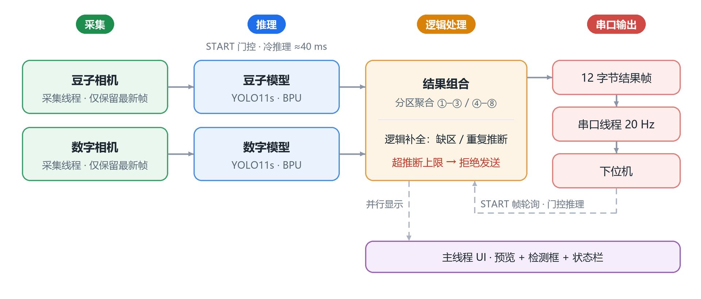

# 🏗️ Crane 视觉模块

**2026 物流技术创意赛 · RDK X5 视觉识别模块** — 双 USB 相机 + 两路 YOLO11 BPU 模型 + 串口，向下位机发送 **12 字节结果帧**。

**🖥️ 运行环境**

| 视觉板 | 相机 | 屏幕 | 训练卡 |
| :---: | :---: | :---: | :---: |
| RDK X5 **8GB**（板载 BPU） | 双 **USB 720p** | **7 寸触摸屏** 1024×600 | **RTX 4060**（YOLO11s） |

[](https://docs.ultralytics.com/)
[](https://developer.horizon.ai/)

---

## 🎯 功能

- **豆子检测**：识别取货区 ①–③ 的豆子种类（白芸豆 / 黄豆 / 绿豆），映射为协议颜色编码（黄豆→1、绿豆→2、白芸豆→3）。
- **数字检测**：识别放置区 ④–⑧ 货箱侧面的数字 1–5。
- **逻辑补全**：缺区/重复时通过全局排列评分推断最可能的值，推断区以橙色框显示；超过上限（豆子 ≤1、数字 ≤2）时拒绝发送。
- **串口输出**：收到下位机 START 帧（`A5 5A 01`）后发送 12 字节结果帧（`A5 5A C1 C2 C3 N4 N5 N6 N7 N8 0D 0A`），START 心跳默认保持 **3.0 秒** 有效，兼容单帧触发或偶发丢包。
- **START 门控推理**：仅在 START 有效时推理（比赛规则要求收到开始指令后才能推理），空闲模型常驻待命，冷推理单帧约 **40 ms**；UI 右侧 **DEBUG** 按钮或 `debug.force_inference` 可强制推理（仅显示，不写串口）。
- **掉线重连**：相机/串口中断后自动重连；UI 状态栏显示 BEAN/DIGIT/SERIAL 状态，离线相机以占位画面提示。
- **性能**：双路采集 + 双模型推理 + 结果组合 + 串口发送全链路约 **19 FPS**。

## 🖼️ 界面预览

竞赛模式 CompetitionUI 截图（x86 静态图片 + PyTorch 推理，**DEBUG:ON** 强制推理）：控件按 7 寸触摸屏加大尺寸，赛前调参更顺手。

<p align="center">
  
</p>

**豆子取货区**：黄色检测框叠加取货区辅助线 ①–③，每区各识别一粒豆子。

<p align="center">
  
</p>

**数字放置区**：④ 区数字缺失时按全局排列评分推断为 `1`，推断区以橙色 **INFER** 标签与黄色检测区区分。

<p align="center">
  
</p>

**校准设置**：辅助线、置信度阈值与推断上限滑块拖动即时预览，**SAVE** 一键写回 `configs/vision.yaml`。

## 🗺️ 运行流程

<p align="center">
  
</p>

两路采集/推理并行执行，在逻辑处理汇合后由串口线程发送；主线程 UI 只做显示，不阻塞采集与推理。

## 🧠 数据集与训练

两路检测模型均为 **YOLO11s**，权重已迭代到 **v7**（`assets/beans_v7.*` / `assets/num_v7.*`，仅保留最终版）。数据集位于 [`data/`](data/)：

| 模型 | 数据集 | 图片量 | 训练 / 验证 / 测试 |
| ---- | ------ | ------ | ---- |
| 豆子 | `data/beans/` | ≈ **3123 张** | 2187 / 624 / 312 |
| 数字 | `data/digits/` | ≈ **4350 张**（已转灰度） | 3045 / 870 / 435 |

标注采用**自动标注 + 人工校验**闭环：用当前权重对新增样本自动标注 → 逐张人工修正标签 → 用更准的标签重训下一版，数据量与标注质量逐版提升至 v7。

## 🚀 快速开始

### 安装依赖

```bash
pip install -r requirements.txt
```

开发机建议使用独立 conda 环境（如 `D:\conda_envs\crane-clean`，Python 3.11），避免 `opencv-python` 与系统包冲突。

### 运行测试

```bash
# 模块级单元测试（x86，mock hobot_dnn）
python -m pytest tools/crane_tests/ -v

# 独立功能测试（x86，直接运行）
python tests/test_logic_completion.py
```

### x86 完整流程测试（CompetitionUI + PyTorch）

`main_amd64.py` 启动 CompetitionUI，双相机同时 PyTorch 推理 + 逻辑补全，无串口依赖：

```bash
# 合成帧
python scripts/main_amd64.py --mock-cameras
# 静态测试图片
python scripts/main_amd64.py --bean-image data/image_for_test/beans_2.jpg --digit-image data/image_for_test/num_2.jpg
```

按键 `1`=豆子 · `2`=数字 · `3`=settings · `d`=DEBUG 强制推理 · `SAVE` 保存配置 · `EXIT` 退出。

### 板端部署（RDK X5）

1. 拷贝 `models/`、`scripts/`、`configs/`、`tests/`、`tools/99-crane-cameras.rules` 与 `assets/*.bin`、`assets/*.yaml`（BPU 部署配置，当前权重版本 `*_v7.*`）到板端工作区。
2. 校准辅助线：`python3 tests/calibrate.py`（x86 无相机时用 `--mock-cameras` 预览）。
3. 启动竞赛模式：`bash scripts/watchdog.sh`（崩溃自动重启）。
4. 下位机发送 START 帧 → 视觉返回 12 字节结果帧。

上电即用的无界面服务：`sudo bash scripts/install_crane_service.sh`。服务以 `main_arm64.py --headless --ui-when-ready` 先启动结果通路，XFCE 就绪后接管同一 UI；校准前先 `sudo systemctl stop crane-vision.service` 释放相机和串口。

## 🔧 配置

运行时唯一事实来源：[configs/vision.yaml](configs/vision.yaml)。关键配置段：

| 段 | 作用 |
| ---- | ------ |
| `serial` | 串口设备、波特率（默认 **921600** 8/N/1）、掉线重连参数 |
| `cameras.bean` / `cameras.digit` | 设备节点、分辨率、帧率、曝光、灰度、掉线重连参数 |
| `models.bean` / `models.digit` | BPU `.bin`/`.cfg`（arm64）或 `.pt`（x86）权重，可选覆盖 `conf_thres`/`iou_thres` |
| `inference` | 输入尺寸 / pad、门控开关 `start_gated` |
| `lines.bean` / `lines.digit` | 竖直辅助线，划分取货区 ①–③ 和放置区 ④–⑧ |
| `mapping.bean_to_digit` | 豆子类别 → 协议颜色编码（黄豆→1、绿豆→2、白芸豆→3） |
| `logic` | 置信度阈值 `confidence_threshold`，推断上限 `max_inferred_beans`/`max_inferred_digits` |
| `ui.controls` | 触摸屏模式、控件尺寸、推理 overlay 开关 |

## 📚 文档

| 文档 | 内容 |
| ------ | ------ |
| [docs/guides/vision_runtime.md](docs/guides/vision_runtime.md) | 运行时入口、状态机与分区映射规则 |
| [docs/guides/RDKx5_Bin_Inference.md](docs/guides/RDKx5_Bin_Inference.md) | YOLO11 BPU 板端推理工作流 |
| [docs/reference/vision_config.md](docs/reference/vision_config.md) | `configs/vision.yaml` 字段与映射规则参考 |
| [docs/reference/CRANE_VISION_PROTOCOL.md](docs/reference/CRANE_VISION_PROTOCOL.md) | 串口硬件接线与 12 字节协议细节 |
| [docs/reference/directory_structure.md](docs/reference/directory_structure.md) | 仓库目录结构、各模块职责与数据集/资产命名 |
| [docs/runbooks/commands.md](docs/runbooks/commands.md) | 完整命令清单（conda 环境、运行、部署、增量同步） |
| [docs/runbooks/rdk_service.md](docs/runbooks/rdk_service.md) | `crane-vision.service` systemd 服务安装与运维 |

## 🚧 约束

- `hobot_dnn` 仅在 RDK X5 上可用；开发机不要运行 `main_arm64.py`，改用 `main_amd64.py` 或 `tests/` 下的独立脚本，单元测试通过 mock 覆盖。
- 串口固定 **921600 8/N/1**、`/dev/ttyS1`；**禁止使用 `/dev/ttyS0`**（系统调试串口）。
- `configs/vision.yaml` 是运行时唯一事实来源，辅助线位置需点击 **SAVE** 手动写回。
- 默认分支 `main`；`master` 是合并视觉运行时之前的历史分支。

## 📄 许可证

[Apache License 2.0](LICENSE)。
