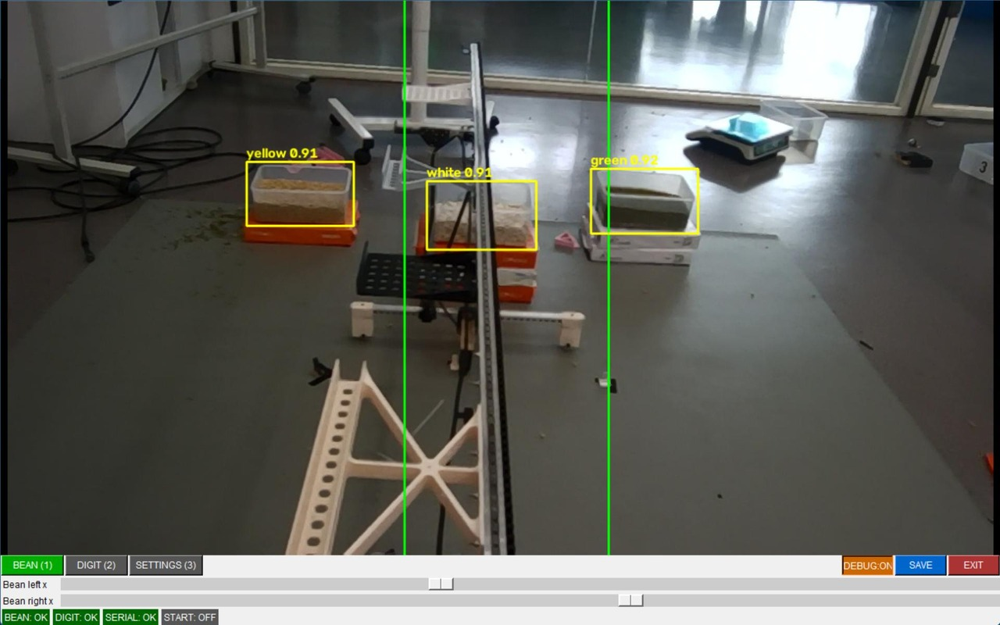
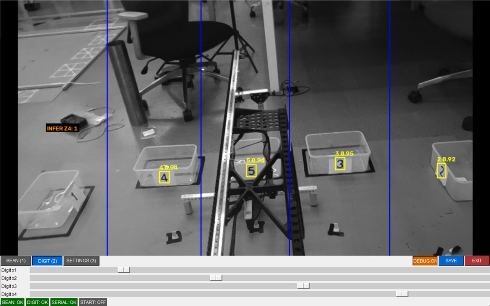
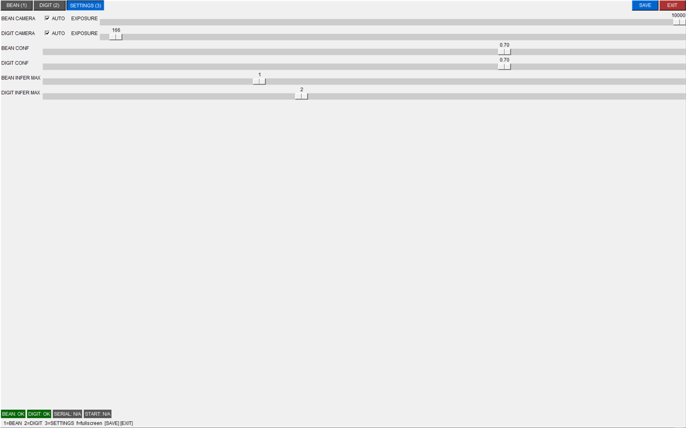
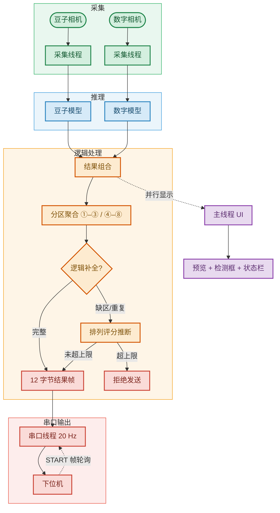

# 🏗️ Crane 视觉模块

> 2026 物流技术创意赛 RDK X5 视觉识别模块
>
> 双 USB 相机 + 两路 YOLO11 BPU 模型 + 串口通信，向下位机发送 12 字节结果帧。

[](https://www.python.org/)
[](https://opencv.org/)
[](https://pypi.org/project/pyserial/)
[](https://docs.ultralytics.com/)
[](https://developer.horizon.ai/)
[](docs/reference/CRANE_VISION_PROTOCOL.md)

---

## 📋 目录

- [功能](#-功能) · [界面预览](#-界面预览) · [运行流程](#-运行流程) · [目录结构](#-目录结构)
- [快速开始](#-快速开始) · [配置](#-配置) · [文档](#-文档) · [约束](#-约束) · [许可证](#-许可证)

---

## 🎯 功能

- **豆子检测**：识别取货区 ①–③ 的豆子种类（白芸豆 / 黄豆 / 绿豆），映射为协议颜色编码（黄豆→1、绿豆→2、白芸豆→3）。
- **数字检测**：识别放置区 ④–⑧ 货箱侧面的数字 1–5。
- **逻辑补全**：缺区/重复时通过全局排列评分推断最可能的值，推断区以橙色框显示；超过上限（豆子 ≤1、数字 ≤2）时拒绝发送。
- **串口输出**：收到下位机 START 帧（`A5 5A 01`）后，发送 12 字节结果帧（`A5 5A C1 C2 C3 N4 N5 N6 N7 N8 0D 0A`）。START 心跳默认保持 **3.0 秒**有效，兼容单帧触发或偶发丢包。
- **掉线重连**：相机/串口连接中断后自动重连；UI 状态栏显示 BEAN/DIGIT/SERIAL 连接状态，离线相机以占位画面提示。

## 🖼️ 界面预览

竞赛模式 CompetitionUI 截图（x86 静态图片 + PyTorch 推理）：

<p align="center">
  
</p>
**豆子取货区检测**：豆子相机画面叠加检测框与取货区辅助线 ①–③。

<p align="center">
  
</p>
**数字放置区检测**：数字相机画面叠加检测框与放置区辅助线 ④–⑧。

<p align="center">
  
</p>
**校准设置面板**：辅助线、置信度阈值与逻辑补全推断上限滑块，SAVE 写回配置。

## 🗺️ 运行流程



## 📁 目录结构

**目录一览**：`assets` · `configs` · `data` · `docs` · `models` · `scripts` · `tests` · `tools`

完整目录结构与各模块职责见 [docs/reference/directory_structure.md](docs/reference/directory_structure.md)。

## 🚀 快速开始

### 安装依赖

运行时与测试依赖：

```bash
pip install -r requirements.txt
```

开发机建议使用独立 conda 环境（如 `D:\conda_envs\crane-clean`，Python 3.11），避免 `opencv-python` 与系统包冲突。 

### 运行测试

```bash
# 模块级单元测试（x86，mock hobot_dnn）
python -m pytest tools/crane_tests/ -v

# 独立功能测试（x86，直接运行）
python tests/test_logic_completion.py
```

### x86 完整流程测试（CompetitionUI + PyTorch）

`main_amd64.py` 启动 CompetitionUI，双相机同时 PyTorch 推理 + 逻辑补全，无串口依赖：

```bash
python scripts/main_amd64.py --mock-cameras
```

使用静态测试图片：

```bash
python scripts/main_amd64.py --bean-image data/image_for_test/beans_2.jpg --digit-image data/image_for_test/num_2.jpg
```

按 `1`=豆子画面，`2`=数字画面，`3`=settings（含推断上限滑块），`SAVE` 保存配置，`EXIT` 退出。

### 校准辅助线

x86 无相机时使用合成帧预览校准 UI：

```bash
python tests/calibrate.py --mock-cameras
```

RDK X5 或开发机接真实相机时去掉 `--mock-cameras`，在实时预览上通过滑块调整辅助线，点击 **SAVE** 手动写回 `configs/vision.yaml`。

### 板端部署

1. 将 `models/`、`scripts/`、`configs/`、`tests/` 与 `assets/*.bin`、`assets/*.yaml`（BPU 部署配置，当前权重版本为 `*_v7.*`，`v7` 是训练权重迭代号，模型仍为 YOLO11）拷贝到 RDK X5。
2. 校准辅助线：
   ```bash
   python3 tests/calibrate.py
   ```
3. 启动竞赛模式（看门狗自动重启）：
   ```bash
   bash scripts/watchdog.sh
   ```
4. 下位机发送 START 帧 → 视觉返回 12 字节结果帧。

RDK 上电竞赛模式建议安装无界面 systemd 服务，避免等待 XFCE 桌面启动：

```bash
sudo bash scripts/install_crane_service.sh
```

服务先从 `main_arm64.py --headless --ui-when-ready` 启动结果通路，并在
XFCE 可用后自动显示竞赛 UI。校准时先执行 `sudo systemctl stop
crane-vision.service` 释放相机和串口。

## 🔧 配置

运行时唯一事实来源：[configs/vision.yaml](configs/vision.yaml)。关键配置段：

| 段 | 作用 |
| ---- | ------ |
| `serial` | 串口设备、波特率（默认 **921600** 8/N/1）、掉线重连参数 |
| `cameras.bean` / `cameras.digit` | 设备节点、分辨率、帧率、曝光、灰度、掉线重连参数 |
| `models.bean` / `models.digit` | BPU `.bin`/`.cfg`（arm64）或 `.pt`（x86）权重，可选覆盖 `conf_thres`/`iou_thres` |
| `lines.bean` / `lines.digit` | 竖直辅助线，划分取货区 ①–③ 和放置区 ④–⑧ |
| `mapping.bean_to_digit` | 豆子类别 → 协议颜色编码（黄豆→1、绿豆→2、白芸豆→3） |
| `logic` | 置信度阈值 `confidence_threshold`，推断上限 `max_inferred_beans`/`max_inferred_digits` |
| `ui.controls` | 触摸屏模式、控件尺寸、推理 overlay 开关 |

## 📚 文档

| 文档 | 内容 |
| ------ | ------ |
| [docs/guides/vision_runtime.md](docs/guides/vision_runtime.md) | 运行时入口、状态机与分区映射规则 |
| [docs/guides/RDKx5_Bin_Inference.md](docs/guides/RDKx5_Bin_Inference.md) | YOLO11 BPU 板端推理工作流 |
| [docs/reference/vision_config.md](docs/reference/vision_config.md) | `configs/vision.yaml` 字段与映射规则参考 |
| [docs/reference/CRANE_VISION_PROTOCOL.md](docs/reference/CRANE_VISION_PROTOCOL.md) | 串口硬件接线与 12 字节协议细节 |
| [docs/reference/directory_structure.md](docs/reference/directory_structure.md) | 仓库目录结构、各模块职责与数据集/资产命名 |
| [docs/runbooks/commands.md](docs/runbooks/commands.md) | 完整命令清单（conda 环境、运行、部署） |
| [docs/runbooks/rdk_service.md](docs/runbooks/rdk_service.md) | `crane-vision.service` systemd 服务安装与运维 |

## 🚧 约束

- `hobot_dnn` 仅在 RDK X5 上可用；x86 侧通过 mock 做单元测试。
- 默认输入尺寸 640×640，letterbox pad 值 127。
- 串口参数：**921600 8/N/1**（`/dev/ttyS1`，禁止使用 `/dev/ttyS0`）。
- 开发机不要运行 `main_arm64.py`（依赖 RDK X5 镜像中的 `hobot_dnn`）；x86 使用 `main_amd64.py` 或 `tests/` 下的独立脚本。
- 分支策略：默认分支 `main`；`master` 为历史分支。

## 📄 许可证

仓库根目录未附带独立 LICENSE 文件，随本项目仓库一起分发。
